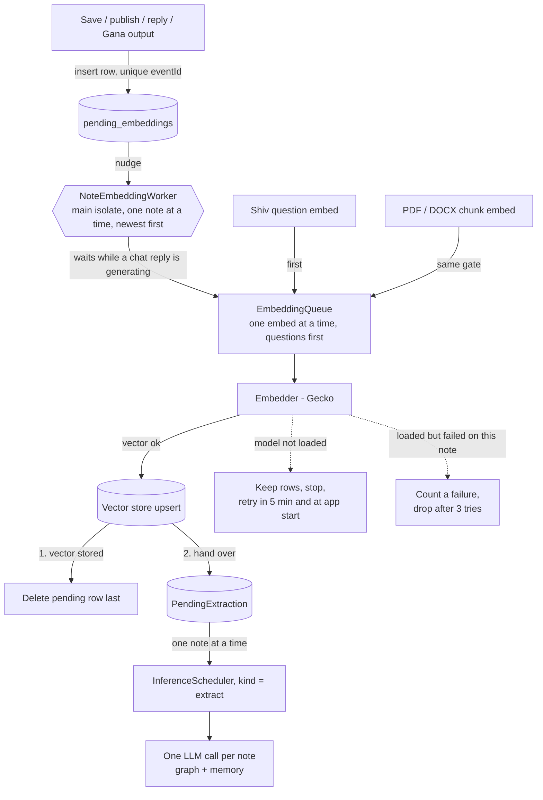

# Embedding — how text becomes a vector

Everything Shiv retrieves is found by similarity between vectors, so the path
from text to vector decides what Shiv can answer. This is how it works today.
Issues: #231 (queue), #125 (batching, not adopted), #232 (store version, not
built), #234 (declared vs real dimension).

## What gets embedded, and when

| Text | Entry point | Priority |
|------|-------------|----------|
| A note the user **saves**, **publishes**, **replies** with, or a **Gana** publishes | `EmbedAndStoreNoteUseCase` → pending table → `NoteEmbeddingWorker` | background |
| A PDF / DOCX / image-text **chunk** | `DocumentIndexer` → `EmbedAndStoreChunkUseCase` | background |
| A Shiv **question** (and Manas context queries) | `EmbeddingService.embed(text)` | interactive |

Feed notes the user only scrolls past, and notes arriving from relays, are not
embedded. A note with fewer than 4 characters after media URLs are stripped is
skipped.

## The pipeline

## The pieces

| Piece | Where | Job |
|-------|-------|-----|
| `PendingEmbeddingModel` / `PendingEmbeddingRepository` | `lib/data/models/`, `lib/data/repositories/` | Notes waiting for a vector. One row per `eventId`, holds the text to embed. Returns `Either<Failure, T>`. |
| `EmbedAndStoreNoteUseCase` | `lib/domain/usecases/vector_usecases.dart` | Strips media URLs, skips text under 4 characters, queues the note, calls the trigger. Never throws. |
| `NoteEmbeddingTrigger` | `lib/domain/services/` | Domain interface (`nudge()`); the worker implements it. |
| `NoteEmbeddingWorker` | `lib/features/shiv/rag/indexing/` | Drains the table. |
| `EmbeddingQueue` | `lib/data/datasources/llm/embedding_queue.dart` | The one gate: one embed in flight, interactive before background. |
| `EmbeddingService` | `lib/features/shiv/rag/embedding/` | Loads Gecko (the 256-token file), embeds long notes in pieces, runs every embed through the gate. |
| `NoteVectorStore` | `lib/data/datasources/note_vector_store.dart` | Where a note's vector is kept: the `tostore` store, in its own isolate, behind a message API. Opened at `tostore_<dim>d_v<N>` (#232). |

## Rules

- **A row is deleted only after its vector is stored.** A kill, a crash or a failing store loses nothing; at worst the note is embedded twice.
- **The table only holds notes that still need a vector.** Empty means no work: a pass is one query. There is no polling and no database watcher; the only timer is the 5-minute retry after a failed pass.
- **When it runs:** when a row is added, at app start (`main.dart`), and after the retry timer. It runs only while the app is open; rows wait for the next launch otherwise.
- **One worker, one note at a time, newest first.** A note queued while it runs sets a "go again" flag, so passes never overlap and nothing is stranded.
- **A vector store failure is not the note's fault.** If saving the vector throws (for example the store isolate stopped), the row is kept, the pass stops and it retries later; it is never counted toward the 3-failure drop, so a store outage cannot cost notes their place in the queue.
- **`embed` answers `[]` for two different reasons.** Model not loaded → keep the note, stop, retry later (`EmbeddingService.isReady` is false). Model loaded but no vector for this text → count a failure and drop the note after 3, or one bad note would block the queue forever.
- **A question waits for at most one embed.** When a slot frees, interactive waiters go before queued background ones. The embed already running cannot be interrupted.
- **Chat first.** The worker waits (polls every 2 s) while `InferenceScheduler.isChatRunning`. Gana, extraction and Nataraj jobs do not hold it back.
- **Knowledge extraction is unchanged:** one on-device LLM call per note, scheduled as `extract`, skipped when no model is active, drained when the user is away from Shiv. The worker only feeds it.
- **Always embed through `EmbeddingService.embed`.** A direct call to the model skips the gate.
- **An over-long text is shortened and retried, not truncated by the plugin.** flutter_edge_ai 2.3 throws `EmbeddingInputTooLongException` (with the token limit and the actual count); `EmbeddingService` cuts the text in proportion, with a 10 % margin, and tries again up to 4 times, then gives up with `[]`.

## Deleting a note

Every deletion path calls `purgeNotesInTxn` (`lib/data/datasources/note_purge.dart`) inside its own transaction: the note, its unread and relation rows, its memory summary, its graph edges (a concept stays while another edge uses it), its pending embed/extract rows, and a `PendingVectorDelete` row are handled together. The vector lives in the store's isolate, so `NoteVectorCleanupWorker` removes it from the queue afterwards, row last. On launch it also sweeps vectors that have no note (never when there are no notes at all) and rebuilds the index once per store format. A note that is still saved keeps its vector and knowledge. Never delete `NoteModel` rows directly.

## Why one at a time

Measured on a vivo 1933 (Snapdragon 710), real Gecko model:

- One embed with the 1024-token file costs **~11.5 s**, whatever the text: 4 characters 11.54 s, ~200 chars 11.53 s, ~1,500 chars 11.57 s, ~6,000 chars 11.61 s. The forward pass is compiled for a fixed input (the model name says 1024 tokens) and a batch of 1, so every call processes a full padded input. This is why the app now embeds with the 256-token file wherever the text fits: see [Two Gecko files](#two-gecko-files-266).
- One at a time, two at a time, `generateEmbeddings` in groups of 4 and all at once all took the same ~46.3 s for 4 notes (1.00x). In the plugin `generateEmbeddings` is one request per text to a single worker isolate, so batching saves nothing (#125).
- The model returns 768-dimension vectors (the "1024" in its name is the input length); the app and the note store now declare 768 (#234).

| | Before the queue | After |
|---|---|---|
| One note stored | 12.1 s | 11.8 s |
| Burst of 4 notes saved at once | all four appear together at ~46.5 s | at 12.4, 24.1, 36.1, 47.8 s |
| A Shiv question right after a burst of 4 | answered after 57.9 s | answered after 23.1 s |

A running embed costs a chat reply roughly 10-20 % and the first token almost
nothing (1.58 → 1.65 s), with the chat model on the GPU and the embedder on the
CPU (two alone samples, one contended: indicative only). The GPU backend is not
an option: flutter_edge_ai runs these embedders on the CPU only.

## One Gecko file, long notes in pieces (#296)

Gecko comes as several files that differ only in their fixed input length
(`litert-community/Gecko-110m-en`). The app bundles only
`gecko_256_quant.tflite` (114 MB, ~1,100 characters per embed). It used to bundle
the 1024-token file too (#266); dropping it made the app 145 MB smaller.

A long note is cut with `chunkSections` into pieces of at most 700 characters
(`EmbeddingService.notePieceChars`), at most 24 pieces (`maxNotePieces`, so
~16,800 characters; the rest is not indexed). `EmbeddingService.embedNote`
embeds each piece as its own queue entry, so a question can run between two
pieces. A piece the 256 file still rejects is split at whitespace near the
middle and retried (depth 4). If any piece fails, the whole note returns no
vectors and is retried later.

Storage: the first piece is stored under the plain note id (so vectors written
before this change stay valid), piece k under `<noteId>#k` (`note_vector_ids.dart`;
`#` never occurs in a hex event id). Every place that touches vectors knows it:

| Place | Behaviour |
|---|---|
| `NoteVectorStore.upsertNote` | Removes the note's old pieces, then writes the new ones. |
| Delete queue / `deleteNote` | Removes the base id and every `#k` piece. |
| Launch sweep | Maps each stored id to its note (`noteIdOfVector`); a live note keeps all pieces. |
| Search | Asks the store for `topK * 5`, keeps the best piece per note, so each note appears once and one note cannot crowd the rest out. |
| Manas scope | Allowed note ids are expanded to their piece ids inside the store. |
| Worker | Stores all pieces, removes the pending row last; extraction gets the first piece's vector. |

Measured on the vivo 1933 (Snapdragon 710), 14 notes of 1,000-2,000 characters
(each with a fact near the start and one near the end), 16 short notes, 3 notes
over 5,000 characters with a fact at the very end; 75 questions. The score of a
note is its best piece. Right note first / in the top 3:

| | Start of long note (28) | End of long note (28) | Short note (16) | End of very long (3) | Time to index long notes |
|---|---|---|---|---|---|
| 700-char pieces, 256 file (shipped) | **27**/28 · 28 | **27**/28 · 28 | 16/16 · 16 | 3/3 · 3 | 126 s (58 pieces) |
| 1,000-char pieces, 256 file | 25 · 27 | 26 · 27 | 16 · 16 | 3 · 3 | 100 s (46 pieces) |
| Whole note, 1024 file (before) | 24 · 27 | 20 · 25 | 16 · 16 | 2 · 3 | 199 s |

700-character pieces match or beat the whole-note 1024 file on every row, and
find the end of a note much more often. Limits of this measurement: the short
questions were easy (16/16 on every variant), so an earlier 15/16 for chunks
(an earlier corpus) did not reproduce but also was not ruled out; one phone;
English only. `integration_test/embedding_pieces_e2e_test.dart` keeps the
guard with the real service (thresholds 24/28, 24/28, 16/16, 3/3).

Scores with pieces (46-note library, 75 questions, 10 unrelated questions):
the right note's best piece scored 0.67 at the lowest, 0.71 at the 10th
percentile; the closest note to an unrelated question scored 0.62-0.81 (six of
ten at 0.71 or more, since a 46-note library has some note near most topics).
This is a bigger and denser library than the 8 notes behind
`PromptBudget.smallModelMinScore` (0.72, answers 0.74-0.85, unrelated at most
0.70), so the two are not comparable and the cut-off was left unchanged: no
single threshold separates the two groups in a library this size.
`integration_test/embedding_pieces_e2e_test.dart` prints these numbers.

An embed is ~2.2 s whatever the text, so a 1,100-character note is 2 pieces
(~4.4 s) and a note at the 24-piece cap is ~53 s of background work, queued
behind questions.

## Not covered

- Notes saved before the queue existed that never got a vector, and a store format change (#232): both need a cheap "has a vector" check first (a note costs ~2.2 s per 700-character piece).
- Notes embedded whole on the 1024 file before #296 keep that one vector (their base id); they are not re-embedded in pieces.
- A very large PDF/DOCX still keeps the embedder busy for a while, now ~2.2 s a chunk instead of ~11.5 s (a 40-chunk PDF: ~1.5 min instead of ~7.8 min).
- Notes over 24 pieces (~16,800 characters) are indexed only up to that cap.

## Tests

- CI: `test/domain/usecases/vector_usecases_test.dart`, `test/data/repositories/pending_embedding_repository_impl_test.dart`, `test/features/shiv/rag/indexing/note_embedding_worker_test.dart`, `test/data/datasources/llm/embedding_queue_test.dart`, `test/features/shiv/rag/embedding/embedding_service_test.dart`, `test/integration/note_embedding_flow_test.dart`, and the note-plus-PDF group in `test/integration/document_rag_flow_test.dart`.
- Device (`integration_test/`, real model): `embedding_pieces_e2e_test` (retrieval quality of notes in pieces), `note_embedding_queue_e2e_test`, `embedding_priority_e2e_test`, `note_save_timing_e2e_test` (runs unchanged on old and new code), `chat_embed_contention_e2e_test`, `embedding_benchmark_test` (run it in profile mode with `flutter drive --driver=test_driver/integration_test.dart --profile`).
